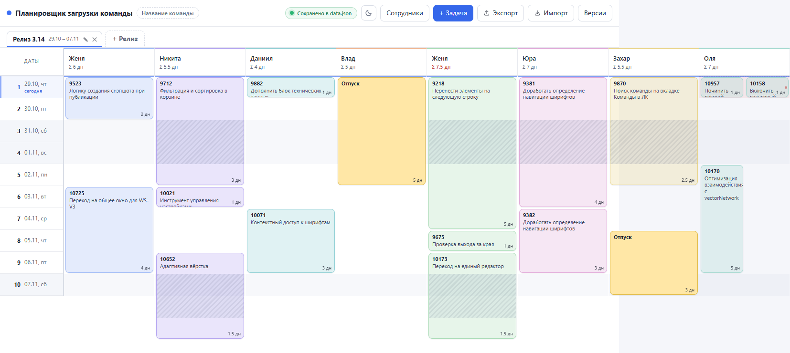

# Планировщик загрузки команды

Доска распределения задач по сотрудникам отдела: **столбцы — люди, строки —
дни релиза**. Видно, кто чем занят в каждый день, где перегруз и сколько дней
всего набралось на человека.

Пишется под отдел тестирования (8–10 человек), но подходит любому отделу.

Что можно делать: завести сотрудников, открыть релиз (он же вкладка) с датами,
добавить задачи, отпуска и больничные. Плашки на доске не перетаскиваются —
исполнитель и дата меняются кликом по плашке.



## Запуск

Двойной клик по **`start.bat`**. При первом запуске рядом появится ярлык
**«Планировщик»** с иконкой — дальше удобнее запускать его.

- Консольного окна нет: сервер работает в фоне и открывает браузер сам.
- Если сервер уже запущен, второй не поднимается — просто откроется вкладка.
- Интернет не нужен.

### Node.js

Для запуска нужен **Node.js** (LTS-версия с [nodejs.org](https://nodejs.org)):
приложение собрано на ES-модулях, а браузер не загружает их со схемы
`file://`. Поэтому `start.bat` поднимает локальный сервер, а он уже отдаёт
страницу браузеру. С сервером работа заметно удобнее:

- правки пишутся в `data/data.json` сами, ничего не нужно экспортировать;
- доступны **Версии** (автобэкапы) и откат к любому снимку;
- данные не привязаны к браузеру: чистка кэша или другой браузер их не потеряют;
- сервер сам выключается, когда закрыта последняя вкладка (см. «Выключение»).

Проверить, что Node.js виден системе: `node -v`. Если его нет, `start.bat`
скажет об этом и предложит установить.

Индикатор в правом верхнем углу показывает, куда идёт запись:

| Индикатор                           | Что значит                           |
| ----------------------------------- | ------------------------------------ |
| «Сохранено в data.json» (зелёный)   | сервер работает, данные на диске     |
| «Нет подключения» (красная заливка) | сервер пропал, правки не сохраняются |

Если сервер упал во время работы, индикатор краснеет сам в течение минуты —
даже без правок (вкладка раз в 30 секунд подаёт сигнал). Когда сервер снова
оживёт, зелёный вернётся сам, но только если правки действительно записались.

Тема — кнопка с солнцем/луной в правом верхнем углу. Выбор сразу применяется
ко всей доске и запоминается: он лежит и в `data.json`, и в самом браузере,
поэтому переживает перезапуск.

## Выключение

**Закройте все вкладки планировщика** — сервер выключится сам примерно через
10 секунд. Отдельной кнопки «выход» нет: так и задумано. Если браузер закрыли
целиком или он упал, сервер заметит молчание вкладок и выйдет за 4–5 минут.
Данные к этому моменту уже в `data.json`, закрывать можно в любой момент.

Проверить, что процессов не осталось:

```
Get-Process node, wscript -ErrorAction SilentlyContinue
```

Пустой вывод — всё выключено. Если `node` остался (браузер упал раньше, чем
сервер это заметил), убейте только наш сервер, а не все `node` на машине:

```
$srv = Get-Content data\server.pid
Stop-Process -Id $srv -Force -ErrorAction SilentlyContinue
```

Если файла нет — найдите процесс по порту (по умолчанию 8787, при занятом
порте сервер берёт следующий):

```
Get-NetTCPConnection -LocalPort 8787 -State Listen | Select OwningProcess
```

## Что показывает доска

- **Σ X дн** в шапке человека — суммарная загрузка за релиз (задачи, отпуск,
  больничный). Красная — задач больше, чем рабочих дней в релизе; отпуск и
  больничный в это сравнение не входят, их количество в подсказке.
- **Перегрузка** — день, где работы больше 1 дня, подсвечен красным.
- **Выходные** (сб/вс) — серым фоном; внутри длинной задачи заштрихованы:
  видно, что работа не идёт, но блок остаётся целым.
- **Сегодня** — синяя линия через доску и подсвеченная строка в колонке дат.
- **Пересекающиеся задачи** рисуются дорожками рядом, а не наезжают друг на друга.
- **Отпуск** — жёлтый, **больничный** — красный.

Задачи считаются в **рабочих днях**: суббота и воскресенье пропускаются, задача
на 2 дня с пятницы займёт пятницу и понедельник. Отпуск и больничный — в
календарных днях. Галочка «Работа в выходные» делает дни календарными.

## Данные

- **Автосохранение** — всё пишется в `data/data.json` рядом с приложением,
  с задержкой ~0.5 с и атомарно (через `.tmp`). Если закрыть вкладку сразу
  после правки, изменение тоже дописывается.
- **Версии** — сервер держит последние 20 снимков в `data/backups/`
  (перед изменением, не чаще раза в 15 сек, и при каждом запуске). Кнопка
  **«Версии»** показывает список с датами и позволяет восстановить любую.
- **Экспорт** — файл `team-planner-YYYY-MM-DD.json` в любое место.
  **Импорт** — загружает такой файл.
- `data/` целиком исключена из git (`.gitignore` + pre-commit хук) — это ваши
  рабочие данные, в репозиторий они не попадают и по HTTP не отдаются.

Версии лежат **на том же диске**, поэтому спасают от случайных удалений, но не
от поломки диска. От этого — периодическая копия через «Экспорт» в облако,
на флешку или в сетевую папку.
