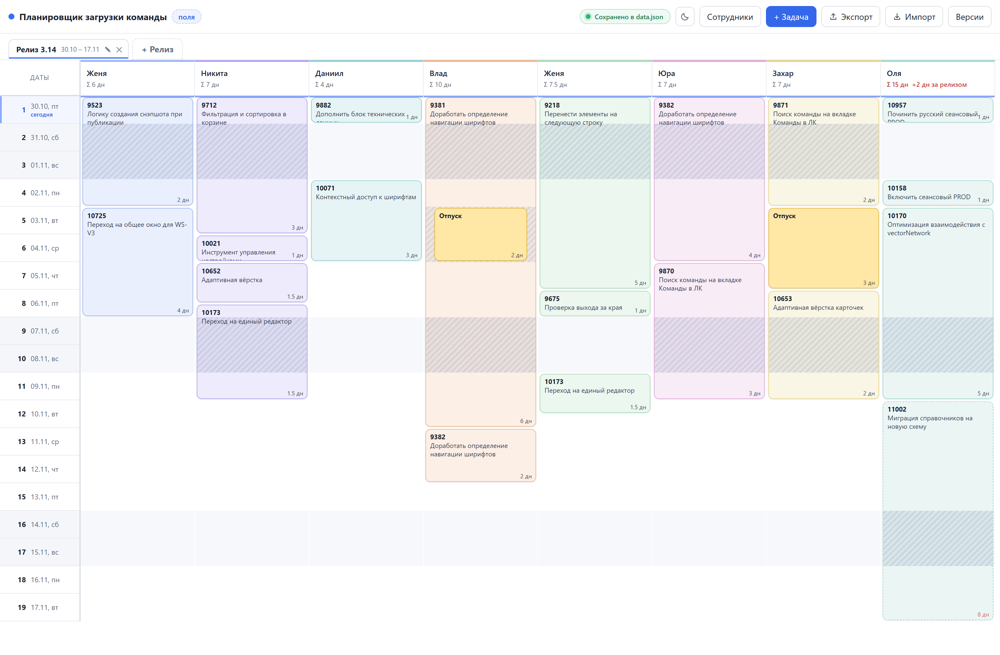

# Планировщик загрузки команды

[](https://github.com/yalosyash/team-planner/actions/workflows/tests.yml?query=branch%3Amain)

Доска задач отдела: **столбцы — сотрудники, строки — дни релиза**.
Помогает распределить работу, учесть отпуска и больничные и увидеть перегрузку.



## Запуск и завершение

1. Установите **Node.js LTS** с [nodejs.org](https://nodejs.org), если его ещё нет.
2. Дважды нажмите **`start.bat`** — планировщик откроется в браузере.
   При первом запуске можно создать ярлык на рабочем столе.
3. Чтобы завершить работу, закройте все вкладки планировщика — сервер
   остановится сам примерно через 10 секунд.

Для повседневной работы интернет не нужен. Перед закрытием дождитесь
индикатора **«Сохранено»**. Если показано **«Нет подключения»**, правки
не сохраняются — оставьте вкладку открытой и восстановите подключение к серверу.

## Как пользоваться

- Добавьте сотрудников и создайте релиз с датами.
- Добавляйте задачи, отпуска и больничные. Нажмите на карточку, чтобы изменить
  её или исполнителя; перетаскивания нет.
- У задач есть ссылка, метки **FE / BE** и статусы **«Не передано» / «Готово»**.
- Задачи считаются в рабочих днях, отпуск и больничный — в календарных.
  Опция **«Работа в нерабочие дни»** позволяет считать задачу в календарных днях.
- В шапке сотрудника показана суммарная загрузка. Перегруженные дни выделены
  красным, задачи за границами релиза — пунктирной рамкой.

## Сохранение и обмен

Данные сохраняются автоматически в **`data/data.json`**.
В правом верхнем углу откройте **«Меню → Резервные копии»**, чтобы восстановить
один из последних 20 снимков.
Периодически делайте **«Экспорт → Все данные»** и храните копию отдельно
от приложения: версии на том же диске не спасут при его поломке.

Через **«Экспорт / Импорт → Только релиз»** можно передать отдельный релиз
коллеге и принять его обратно. Перед заменой приложение покажет изменения
и запросит подтверждение. Импорт всех данных заменяет всю доску.

## Обновление

О новой версии сообщает синяя точка на кнопке меню.
[Скачать последнюю версию](https://github.com/yalosyash/team-planner/releases/latest).

Перед обновлением экспортируйте все данные, закройте приложение и дождитесь
остановки сервера. Распакуйте новую версию в отдельную папку и перенесите туда
**`data/`** и **`settings/`** из старой установки. Папку `runtime/` переносить
не нужно. Запустите новый `start.bat`.

Подробные действия, правила расчёта и ответы на вопросы — в
[справочнике Team Planner](docs/product/README.md).

## Выпуск версии

На GitHub откройте **Releases → Draft a new release**, создайте новый тег
с нужной версией (например, `v1.2.3`), выберите ветку с нужными изменениями
и нажмите **Publish release**. Допускается и тег без `v`: `1.2.3`.
Вручную менять версию в файлах или собирать архив не нужно.

Workflow **Package release** автоматически прикрепит к релизу
`TeamPlanner-vX.Y.Z.zip`. Дождитесь его успешного завершения: до этого
архив ещё не доступен. Версия приложения внутри архива автоматически
берётся из тега релиза; исходники в репозитории при этом не меняются.
Используйте формат версии `X.Y.Z`, например `1.2.3`.

В архив входят только отслеживаемые Git файлы `app/`, `lib/`, сервер,
сценарии запуска и короткая инструкция. Тесты, зависимости разработки,
технические документы и личные данные в него не включаются.
Пользователю нужен Node.js, но не нужен `npm install`.
Кнопка обновления приложения открывает страницу последнего стабильного
релиза, где пользователь скачивает этот архив вместо **Source code**.

Для локальной проверки упаковки на Windows:

```powershell
powershell -NoProfile -ExecutionPolicy Bypass -File scripts/package-release.ps1 -Tag v1.0.0
```

Укажите нужную версию в теге. Архив появится в `dist/`; существующий файл
не перезаписывается. Для повторной проверки задайте другую папку через
`-OutputDirectory`.

## Проверка изменений

Для тестов нужен Node.js 22.12 или новее. Из корня проекта:

```powershell
npm ci
npx playwright install chromium
npm run test:check
npm run test:unit
npm run test:node
npm run test:e2e
```

На Windows дополнительно выполните `npm run test:windows` — проверку запуска
и установки через WSH. Тесты используют временные синтетические данные.
Подробнее об изоляции и составе наборов — в [tests/README.md](tests/README.md).

При ошибке браузерного теста `npm run test:e2e:report` открывает HTML-отчёт
со screenshot и trace. В [GitHub Actions](https://github.com/yalosyash/team-planner/actions/workflows/tests.yml)
откройте запуск и упавшее задание: причина видна в логах, отчёт и артефакты
доступны в разделе **Artifacts** запуска и хранятся 14 дней.
Итоговая проверка **QA result** требует успеха всех обязательных заданий.
Бейдж сверху показывает результат push в `main`; остальные ветки имеют
собственные результаты в Actions. Ручные проверки и отложенный расширенный
набор бейдж не подтверждает.
