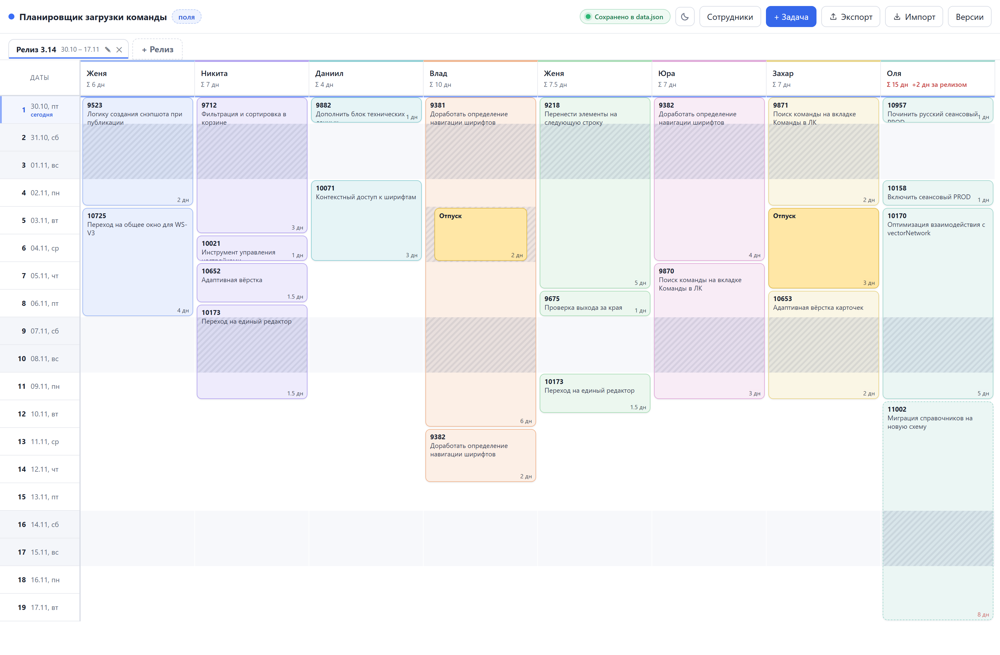

# Подробное руководство

Доска распределения задач по сотрудникам отдела: **столбцы — люди, строки —
дни релиза**. Видно, кто чем занят в каждый день, где перегруз и сколько дней
всего набралось на человека.

Пишется под отдел тестирования (8–10 человек), но подходит любому отделу.

Что можно делать: завести сотрудников, открыть релиз (он же вкладка) с датами,
добавить задачи, отпуска и больничные. Плашки на доске не перетаскиваются —
исполнитель меняется кликом по плашке.



Пошаговые сценарии, ошибки и объяснение результатов собраны в
[справочнике](product/README.md#найти-ответ-по-действию-или-вопросу).

## Запуск

Двойной клик по **`start.bat`**. При первом запуске появится вопрос, создать ли
на рабочем столе ярлык **«Планировщик»**. Ответ сохраняется в
секции `launcher` файла `settings/system.json`: повторно вопрос не задаётся,
удалённый ярлык не восстанавливается. Если ярлык уже есть, вопрос не появляется.

- Консольного окна нет: сервер работает в фоне и открывает браузер сам.
- Если сервер уже запущен, второй не поднимается — просто откроется вкладка.
- Интернет не нужен.

### Node.js

Для запуска нужен **Node.js** (LTS-версия с [nodejs.org](https://nodejs.org)):
приложение собрано на ES-модулях, а браузер не загружает их со схемы
`file://`. Поэтому `start.bat` поднимает локальный сервер, а он уже отдаёт
страницу браузеру. С сервером работа заметно удобнее:

- правки пишутся в `data/data.json` сами, ничего не нужно экспортировать;
- доступны **резервные копии** (автобэкапы) и откат к любому снимку;
- данные не привязаны к браузеру: чистка кэша или другой браузер их не потеряют;
- сервер сам выключается, когда закрыта последняя вкладка (см. «Выключение»).

Проверить, что Node.js виден системе: `node -v`. Если его нет, `start.bat`
скажет об этом и предложит установить.

Индикатор в правом верхнем углу показывает, куда идёт запись:

| Индикатор                           | Что значит                           |
| ----------------------------------- | ------------------------------------ |
| «Сохранено» (зелёная точка)         | сервер работает, данные на диске     |
| «Нет подключения» (красная заливка) | сервер пропал, правки не сохраняются |

Если сервер упал во время работы, индикатор краснеет сам в течение минуты —
даже без правок (вкладка раз в 30 секунд подаёт сигнал). Когда сервер снова
оживёт, зелёный вернётся сам, но только если правки действительно записались.

Тема — кнопка с солнцем/луной в правом верхнем углу. Выбор сразу применяется
ко всей доске и запоминается в `settings/preferences.json`, поэтому переживает
перезапуск. В браузерном режиме настройки хранятся отдельно от доски в браузере.

## Выключение

**Закройте все вкладки планировщика** — сервер выключится сам примерно через
10 секунд. Отдельной кнопки «выход» нет: так и задумано. Если браузер закрыли
целиком или он упал, сервер заметит молчание вкладок и выйдет за 4–5 минут.
Перед закрытием убедитесь, что индикатор показывает «Сохранено».

Проверить, что процессов не осталось:

```
Get-Process node, wscript -ErrorAction SilentlyContinue
```

Пустой вывод — всё выключено. Если `node` остался (браузер упал раньше, чем
сервер это заметил), убейте только наш сервер, а не все `node` на машине:

```
$srv = Get-Content runtime\server.pid
Stop-Process -Id $srv -Force -ErrorAction SilentlyContinue
```

Если файла нет — найдите процесс по порту (по умолчанию 8787, при занятом
порте сервер берёт следующий):

```
Get-NetTCPConnection -LocalPort 8787 -State Listen | Select OwningProcess
```

## Что показывает доска

- **FE / BE** — необязательные независимые метки задачи. В окне задачи можно
  выбрать одну, обе или ни одной. На карточке они стоят перед номером
  (без номера — перед словом «Задача»), цвет карточки сохраняется.
  У отпуска и больничного меток нет. Метки сохраняются и входят в JSON
  экспорта; старые задачи открываются без меток.

- **Σ X дн** в шапке человека — суммарная загрузка за релиз (задачи, отпуск,
  больничный). Красная — задач больше, чем рабочих дней в релизе; отпуск и
  больничный в это сравнение не входят, их количество в подсказке.
- **+N дн за релизом** рядом с «Σ» — у человека есть задачи, которые не
  влезают в конец релиза. Их карточки обрезаны по последнему дню и помечены
  пунктирной рамкой: это не ошибка, данные сохраняются целиком.
- **Перегрузка** — день, где работы больше 1 дня, подсвечен красным.
- **Нерабочие дни** по календарю — серым фоном; внутри длинной задачи заштрихованы:
  видно, что работа не идёт, но блок остаётся целым. Дни отпуска и больничного
  внутри задачи заштрихованы так же, а сам отпуск рисуется поверх задачи
  отдельной плашкой.
- **Сегодня** — синяя линия через доску и подсвеченная строка в колонке дат.
- **Отпуск** — жёлтый, **больничный** — красный.
- **Статус задачи** — у задачи может быть одна из трёх меток (переключатель
  в окне задачи, над «Рабочих дней»):
  - **Обычная** — без метки;
  - **«!» Не передано** — янтарная подсветка карточки и рамка, значок в правом
    верхнем углу. При наведении на значок рядом с верхним краем карточки
    появляется красная пилюля «Не передано» — сама по себе, без плашки;
  - **«✓» Готово** — зелёная рамка и значок, заливка обесцвечена
    (задача как бы уже выполнена), цвет текста не меняется. Пилюля у значка —
    «Готово», того же вида и с тем же контрастом, что красная.
- **Ссылка на задачу** — поле «Ссылка» в окне задачи (под номером). Без схемы
  адрес дополняется `https://` (`jira.company.ru/browse/1234` работает
  как есть), допускаются только `http://` и `https://`. Если у задачи есть и
  номер, и ссылка, номер на карточке становится кликабельным и открывается
  в новой вкладке — окно задачи при этом не открывается, остальная карточка
  по-прежнему кликабельна. Ссылка без номера на доске не показывается (она
  остаётся в данных и в окне задачи), у отпуска и больничного ссылки нет.

Задачи считаются в **рабочих днях** по загруженному российскому календарю:
учитываются праздники и рабочие переносы. Если календарь года недоступен,
используется пятидневка с выходными в субботу и воскресенье. При обычной
пятидневке задача на 2 дня с пятницы займёт пятницу и понедельник.
Отпуск и больничный считаются в календарных днях. Галочка
«Работа в нерабочие дни» включает в расчёт задачи и нерабочие даты.
Подробнее — [правила календаря](product/03-business-rules.md#br-calendar-001-рабочие-и-нерабочие-дни).

## Данные

При обновлении старой установки выполняется миграция с резервированием
исходных файлов. Порядок переноса и действия при ошибке описаны в
[справочнике](product/06-storage-and-exchange.md#st-migrate-001--переход-старой-установки).

- **Автосохранение** — рабочие данные пишутся в `data/data.json` рядом с приложением,
  с задержкой ~0.5 с и атомарно (через временный файл). Перед закрытием
  дождитесь «Сохранено»: попытка дописать правку при закрытии не гарантирует
  её доставку серверу. При ошибке оставьте вкладку открытой; см.
  [сохранение и повторные попытки](product/06-storage-and-exchange.md#st-save-001--как-понять-что-изменения-сохранены).
- **Резервные копии** — сервер держит последние 20 снимков в `data/backups/`
  (перед изменением, не чаще раза в 15 сек, и при каждом запуске). Пункт
  **«Меню → Резервные копии»** в правом верхнем углу показывает список с датами и позволяет восстановить любую.
- **Экспорт** и **Импорт** открывают меню с пунктами **«Все данные»** и
  **«Только релиз»**. Экспорт всех данных сохраняет файл
  `team-planner-YYYY-MM-DD.json`; импорт всех данных заменяет доску, сохраняя
  тему и календарь получателя. Текущий релиз остаётся выбранным, если он есть
  в новой доске; иначе выбирается первый. Пустая доска не имеет выбранного релиза.
- **Экспорт → Только релиз** открывает окно выбора любого существующего
  релиза (по умолчанию выбран текущий) и передаёт его задачи,
  отпуска/больничные и сотрудников с задачами. Календарь и настройки приложения
  не передаются: каждый использует свой производственный календарь.
- **Импорт → Только релиз** открывает выбор файла, затем предпросмотр с датами и количеством
  добавляемых, изменяемых и удаляемых задач (включая изменения порядка).
  При первом импорте сопоставьте людей вручную или выберите «Добавить нового».
  Совпадение имени — подсказка; выбор запоминается для следующих передач этого
  релиза. Имена, цвета и порядок существующих сотрудников сохраняются.
- При возврате релиз узнаётся по сохранённой связи. Заменяется только он,
  целиком; задачи, удалённые коллегой, удаляются и у получателя. Совпадение
  номера и дат не связывает независимые релизы. Параллельные правки и возможный
  устаревший возврат вызывают предупреждение. Замена требует подтверждения;
  автоматического объединения нет. Уже импортированный файл повторно не применяется.
- Перед импортом всей доски или релиза и перед восстановлением версии создаётся
  резервная копия текущей доски из памяти, включая ещё не сохранённые правки,
  доступная через **«Меню → Резервные копии»**; если копию сохранить не удалось, импорт отменяется.
  В браузерном режиме хранится одна копия перед последней заменой доски.
  В предпросмотре также можно скачать текущие данные отдельно.
- Полный импорт принимает JSON до 5 МБ, проверяет формат и связи. Старые файлы
  поддерживаются; их тема, календарь и прочие локальные поля не применяются.
  Импорт отдельного релиза выбирает импортированный релиз.
- При конфликте с другой вкладкой устаревшая запись отклоняется. Экспортируйте
  несохранённые правки перед обновлением страницы.

### Где хранятся файлы

| Путь                          | Содержимое                                                                                |
| ----------------------------- | ----------------------------------------------------------------------------------------- |
| `data/data.json`              | Команда, сотрудники, релизы, задачи и связи обмена                                        |
| `data/backups/`               | Последние 20 обычных снимков доски, включая копии перед заменой                           |
| `settings/preferences.json`   | Тема и выбранный релиз                                                                    |
| `settings/system.json`        | Производственный календарь, ответ о ярлыке и служебные отметки                            |
| `settings/migration-backups/` | Точные исходники перехода со старого хранения и манифесты; не входят в ротацию 20 снимков |
| `runtime/`                    | `server.pid`, `server.log` (ограничен 1 МБ) и блокировки записи                           |

`data/`, `settings/` и `runtime/` исключены из Git и статической раздачи HTTP.
Защитный pre-commit хук дополнительно проверяет эти пути, если он подключён
в локальном репозитории. Контракт форматов: [STORAGE-FORMATS.md](STORAGE-FORMATS.md).

При первом запуске обновлённого приложения старые данные переносятся автоматически.
До изменения JSON создаются и проверяются точные копии в
`settings/migration-backups/`. Существующие новые настройки имеют приоритет.
После сбоя повторный запуск продолжает переход; повреждённый JSON или живой
старый PID останавливают запуск с диагностикой вместо открытия пустой доски.

### Перенос и восстановление

Для переноса доски с историей закройте приложение, дождитесь остановки сервера
и скопируйте `data/` целиком в отдельную установку. Тема, выбранный релиз,
календарь и ответ о ярлыке настраиваются там локально. При отсутствии выбора
открывается первый релиз. Новые экспорты и снимки содержат только рабочие данные.
Исторические снимки старого формата могут содержать прежние локальные сведения;
они сохраняются без переписывания, но при восстановлении эти поля игнорируются.

Получатель использует свой производственный календарь: расположение рабочих
задач может пересчитаться. Даты отпусков и больничных сохраняются. Для года без
загруженного календаря используется пятидневка; при доступной сети календарь
загружается штатно.

Если переносите собственную установку при обновлении и хотите сохранить
окружение, копируйте также `settings/`. `runtime/` не переносите.
Для восстановления обычной версии откройте «Меню → Резервные копии»: окружение сохраняется,
ошибка резервирования или конфликт записи отменяет замену.

При ошибке запуска проверьте сообщение и `runtime/server.log`, если он создан.
Сохраните `data/` и `settings/`, включая миграционные копии. Не удаляйте JSON
или блокировки ради повторного запуска: сначала остановите писателей и проверьте
PID/владельца. После аварии могут остаться lock/tmp-файлы; автоматическая подмена
ими живого JSON не выполняется. Миграционные копии предназначены для ручного
восстановления при остановленном сервере и автоматически не удаляются.

В режиме без серверного API доска, личные и системные настройки хранятся
раздельно в localStorage этого браузера и адреса сайта. Очистка данных сайта
удаляет их, поэтому сохраняйте экспорт отдельно. Без Web Locks или Crypto
доступны чтение и полный экспорт, редактирование отключается. Ошибка записи
сервера не переключает приложение незаметно на браузерное хранилище.

Версии лежат **на том же диске**, поэтому спасают от случайных удалений, но не
от поломки диска. От этого — периодическая копия через «Экспорт» в облако,
на флешку или в сетевую папку.

## Обновления приложения

Планировщик проверяет обновления при запуске и затем раз в час, пока вкладка
видима. При возвращении во вкладку проверка выполняется, если прошёл час
с предыдущей попытки. При обнаружении новой версии на кнопке «Меню» появляется
синяя точка. Внутри меню пункт «Проверить обновления» меняется на
«Доступна версия X.Y.Z» и открывает страницу релиза.
Скачивание и установка выполняются вручную; проверка не меняет код и данные.
Без интернета планировщик продолжает работать, проверку можно повторить позже.
Текущая версия указана внизу меню приложения.

Последний релиз: https://github.com/yalosyash/team-planner/releases/latest.

### Как выпустить релиз

1. Обновите `APP_VERSION` в `app/js/core/version.js` (например, `1.0.1`),
   сохраните изменения в коммите и отправьте их в `main`.
2. На GitHub откройте Releases → Draft a new release. Создайте тег с той же
   версией (`v1.0.1`), выбрав ветку `main`.
3. Заполните название и описание изменений, отметьте Set as latest release
   и нажмите Publish release. Для обычного выпуска не отмечайте pre-release.
4. GitHub добавит архив Source code (zip). Первую версию публикуйте как `v1.0.0`.

Для ручного обновления сначала экспортируйте все данные. Распакуйте новую
версию в отдельную папку, закройте старое приложение и дождитесь остановки
его сервера. Перенесите папку `data` целиком (включая резервные копии) в новую
папку приложения; для сохранения собственного окружения перенесите также
`settings/`, если она есть. `runtime/` оставьте в старой папке. Запустите новую
версию через `start.bat`; старый сервер одновременно не запускайте.

Локальные проверки и их ограничения описаны в [QA-плане](QA-PLAN.md).
